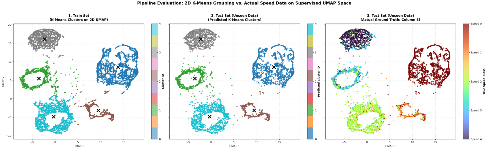
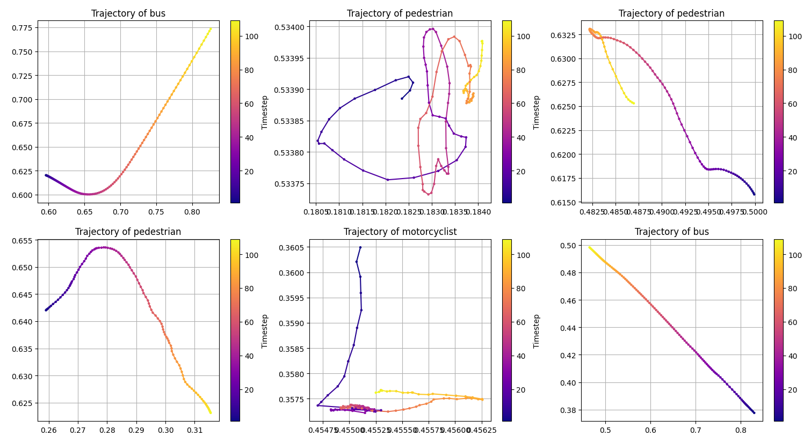
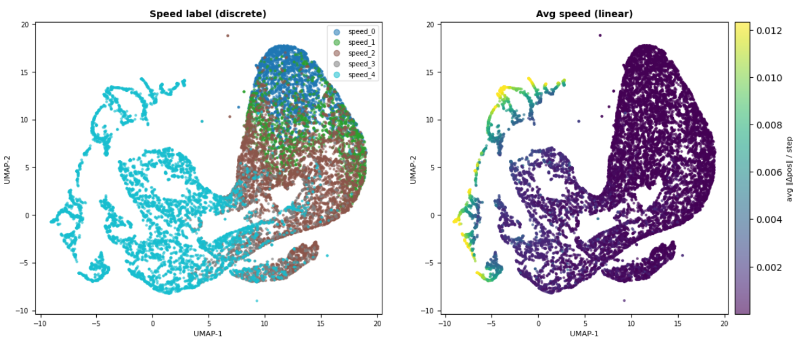
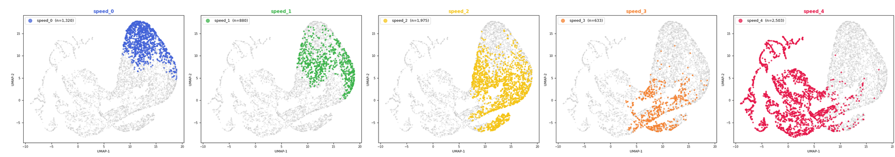
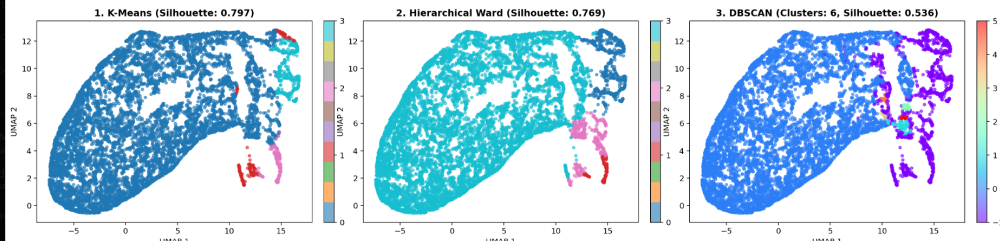
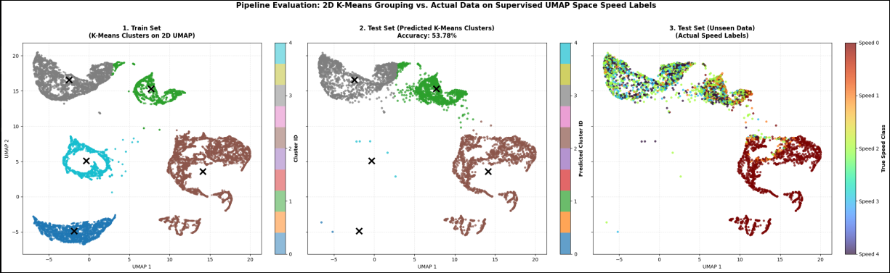
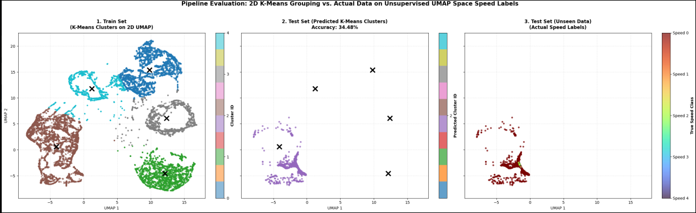

# Trajectory Representation Learning on Argoverse 2

Unsupervised representation learning for motion trajectories. Real-world agent trajectories from the **Argoverse 2 Motion Forecasting** dataset are compressed into a compact, continuous, low-dimensional latent space, which is then analysed, clustered and stress-tested with noise. Three architectures are compared:

- a **Sequence-to-Sequence Variational Autoencoder** with bidirectional GRUs (main model)
- a simple **feed-forward motion predictor**
- a **Transformer autoencoder**

> Team project (Team 5), University of Patras, 2025.

## Goals

1. Show that the model organises trajectories by higher-level semantic properties (such as agent type or speed) without any supervision.
2. Evaluate the learned latent representations on downstream tasks such as motion prediction, and check how well they generalise to an unseen test set.
3. Compare different neural network architectures and pick the most suitable one for this application.

## Key results

| | Seq2Seq VAE | Motion Predictor | Transformer AE |
|---|---|---|---|
| Speed separation in latent space | Best, smoothest | Good | Weakest of the three |
| Speed classification on test set (guided clustering + K-Means) | **84%** weighted avg | — | — |
| Accuracy under input noise | 53% (5 clusters collapse to 3) | — | 34% (all points in one cluster) |
| Best latent dimension | 8 | — | 8 |

- **Average speed** is by far the dominant factor in how all models organise the latent space.
- Agent types are partially separated without supervision (pedestrians vs. fast vehicles occupy distinct regions).
- Finer behaviours such as **turns and acceleration/deceleration were not captured**, most likely because the raw data is very noisy and the training budget (15 epochs, ~64k trajectories) was limited.
- The VAE's KL regularisation gives it the most structured latent space and the best robustness to noise.

<p align="center">
  
  <br><em>K-Means on the guided (supervised) UMAP of the VAE latent space: train clusters, predicted test clusters, and true test speed labels.</em>
</p>

## Dataset

[Argoverse 2 (AV2) Motion Forecasting](https://www.argoverse.org/av2.html) is a large-scale, modern autonomous-driving dataset with hundreds of thousands of detailed real-world trajectories of road agents (vehicles, pedestrians, cyclists, motorcyclists and more), recorded in urban environments at 10 Hz.

The dataset is **not included** in this repository. Download it from the official site and point the preprocessing scripts at the `train/`, `val/` and `test/` folders.

### Preprocessing pipeline

| Step | Script | What it does |
|---|---|---|
| 1 | `preprocess2` | AV2 stores one `.parquet` file per scenario, which is slow and space-hungry. Merges all scenarios from a parent folder (`train` / `val` / `test`) into a single dataset. |
| 2 | `extract_features` | Computes per-trajectory labels (acceleration, direction of motion) and writes an augmented `.parquet` dataset. Because the raw data is dominated by vehicles, vehicle trajectories from the train and validation splits are not kept, for a more even class distribution. |
| 3 | `normalize.py` | Subtracts each trajectory's starting point so every trajectory begins at `(0, 0)` and saves them as `.npy`. Encodes the labels into a separate `.npy` file and saves trajectory IDs to a `.txt` file for later lookup. |
| 4 | `create_train_test_dataset` | Merges trajectories from all original splits into one array and shuffles it while keeping IDs and labels aligned. Normalises each axis by its maximum over the training trajectories and adds a speed label. Outputs 6 files: trajectories, labels and IDs for train and test. |
| 5 | `noisy_outputs.py` | Creates noisy copies of `test_array.npy`: one with noise over the whole trajectory (for the autoencoders) and one with noise of equal power only on the first 49 points (for motion prediction). |

### Data format

After preprocessing, each trajectory has **50 `(x, y)` points** (100 values) and the following labels:

| Label | Values |
|---|---|
| **Object type** (from AV2) | vehicle, pedestrian, construction, riderless_bicycle, bus, background, static, cyclist, motorcyclist, unknown |
| **Direction** (computed) | straight, u-turn, left turn, right turn, unspecified |
| **Acceleration** (computed) | constant speed, decelerate, accelerate |
| **Speed** (computed, normalised units) | `> 0.01`, `0.005–0.01`, `0.001–0.005`, `0.0005–0.001`, `< 0.0005` |

<p align="center">
  
  <br><em>Six random raw trajectories; colour encodes the timestep, showing the direction of motion.</em>
</p>

## Models

### 1. Sequence-to-Sequence VAE (main model)

**Encoder:** a bidirectional GRU that reads the sequence in both temporal directions. Input can be either positions `(x, y)` or displacements `(dx, dy)`. Mean pooling over all hidden states gives a fixed-size representation regardless of trajectory length; this is mapped to a mean and variance and sampled via the reparameterisation trick into an **8-dimensional** latent space.

**Decoder (`GRUDecoder`):**
- **Initialisation:** the latent vector `z` goes through a fully connected layer with `tanh` and is reshaped into the GRU's initial hidden state.
- **Reconstruction:** at each timestep the GRU receives the previous prediction, and a final linear layer outputs the prediction for that step.
- **Training aids:**
  - *Reversed-target trick:* the decoder learns to reproduce the trajectory reversed in time, which helps with long-range dependencies.
  - *Scheduled sampling:* with probability `tf_prob` the ground truth is fed to the next step, otherwise the model's own prediction. `tf_prob` decays linearly from 1.0 to 0.3 over the first 10 epochs.

**Loss** (maximising the ELBO):

```
L    = L_recon + w_KL * L_KL
L_KL = -0.5 * sum(1 + log(σ²) - μ² - σ²)
```

where `L_recon` is the Smooth L1 reconstruction loss.

| Hyperparameter | Value |
|---|---|
| Optimizer | AdamW (lr `1e-3`, weight decay `1e-5`) |
| LR schedule | Cosine annealing |
| KL warm-up | `w_KL` rises linearly from 0 to `1e-3` over 20 epochs (prevents KL collapse) |
| Gradient clipping | max norm 1.0 |
| Latent dimension | 8 (best in experiments) |

**Training results (15 epochs):** train reconstruction error `0.00005`, validation reconstruction error `0.00011`, KL divergence `0.0924`.

### 2. Motion Predictor (feed-forward)

A small fully connected network that predicts the 50th point of a trajectory from the first 49.

| Layer | Size | Activation |
|---|---|---|
| Input | 49 × 2 | — |
| Hidden | 32 | tanh |
| Latent | d | tanh (used as the latent representation) |
| Output | 2 (`x`, `y`) | — |

Trained for d = 2, 4, 6, 8, 10, 12, 14, 16 with lr `0.001`, 5 epochs, batch size 64.

### 3. Transformer Autoencoder

**Encoder:** input `50 × 2` → linear projection to 128 dims → positional encoding → 3 Transformer blocks (LayerNorm + 4-head self-attention, LayerNorm + feed-forward) → mean pooling over timesteps → linear bottleneck to the latent space.

**Decoder:** linear expansion from the latent to 128 dims → positional encoding → 3 Transformer blocks → output layer reconstructing `(x, y)`.

**Objective:** MSE on per-timestep differences `(dx, dy)` instead of absolute positions, so the model focuses on encoding velocity rather than shape.

Trained for d = 2, 4, 8, 16 (best: 8) with lr `1e-3`, 15 epochs, batch size 256, AdamW (weight decay `1e-5`).

## Latent space analysis

Trajectories in the VAE latent space are organised mainly by **average speed**. Fast vehicles and motorcycles sit at one edge, pedestrians form a separate band, and the main mass consists of static objects and very slow vehicles, which are impossible to tell apart from trajectory geometry alone.

<p align="center">
  
</p>

Unseen test trajectories map to the same speed regions as the training data, which shows the representation generalises.

<p align="center">
  
</p>

**Effect of latent dimension:** with very small d (2, 4) labels start to mix, speed is less distinct and test performance drops. Beyond d = 8 there is no further improvement, only more storage.

## Clustering

Standard **K-Means, DBSCAN and hierarchical clustering** applied directly to the latent space all behaved the same way: they split the sparse high-speed region into many small clusters and pushed everything else into a single large one.

<p align="center">
  
</p>

Two fixes were tried:

1. **K-Means on a UMAP projection** of the latent space, optionally using many clusters and manually merging them into label groups.
2. **Guided clustering**: a supervised UMAP transform that pulls same-label points together and pushes different labels apart, preserving speed information so K-Means works much better on top of it.

Guided clustering gave the most consistent results. On the VAE, K-Means on the guided UMAP space, with each cluster mapped to its most common speed class, reached **84% weighted accuracy on 5,000 unseen test trajectories**:

| Speed class | F1-score |
|---|---|
| Speed 0 | 0.95 |
| Speed 1 | 0.62 |
| Speed 2 | 0.82 |
| Speed 3 | 0.66 |
| Speed 4 | 0.88 |

The intermediate classes (1 and 3) are confused with their neighbours, which is expected: speeds near a class boundary are geometrically very close to both sides. Errors go to adjacent classes, not distant ones.

The same analysis was run for the Motion Predictor and the Transformer across d = 2, 4, 8, 16 and all four label types; both achieve reasonable speed separation, with the Transformer being the weakest.

## Robustness to noise

Noisy test sets were used to extract labels through the guided-clustering pipeline.

- **VAE:** accuracy drops to **53%**; the 5 speed clusters collapse to 3, but the overall speed structure is largely preserved.
- **Transformer:** almost all points fall into a single cluster, with **34%** accuracy, effectively chance level.

| VAE | Transformer |
|---|---|
|  |  |

## Conclusions

**What makes a good trajectory representation.** It should be compact, continuous and semantically rich: it should capture kinematic properties like speed rather than raw coordinates, ignore irrelevant noise, and form a smooth space where similar trajectories are close together. Clustering mistakes should land in neighbouring classes, not distant ones.

**Architecture comparison.**
- **Seq2Seq VAE:** the KL term forces the most structured and smooth latent space; best for unsupervised pattern discovery and most robust to noise.
- **Motion Predictor:** simplest and fastest for next-position prediction, but without strong regularisation its latent space is somewhat less separable.
- **Transformer:** the `(dx, dy)` objective makes it encode velocity rather than shape, and stacking blocks plus positional encoding helps, but without a KL-like regulariser it cannot match the VAE's smoothness and gives the weakest separation.
- **Clustering:** classic algorithms cannot handle the density differences in the latent space; guided clustering and K-Means on UMAP projections clearly outperform them.

**Latent dimension.** d = 2–4 underfits and mixes classes; **d = 8** is the sweet spot; d > 16 adds cost and possible overfitting with no gain.

## Limitations

- **Static vs. very slow objects:** using only `(x, y)` geometry, a near-zero-length trajectory looks identical whatever the agent is. Fully solving this would need extra inputs such as camera images or 3D LiDAR.
- **Fine-grained behaviours:** turns and acceleration/deceleration were not separated in the latent space, likely because of noisy data and the limited training budget.
- **Noise sensitivity:** all models degrade with noisy inputs, the Transformer far more than the VAE (possibly thanks to the VAE's stochastic nature and smooth latent space).

## Authors

Team 5, University of Patras (2026):

- Ioannis-Dionysios Vardakastanis
- Efstratios Gryparis (@stratis1234)
- Anastasios Kanellopoulos
- Georgios Tzormpatzakis
